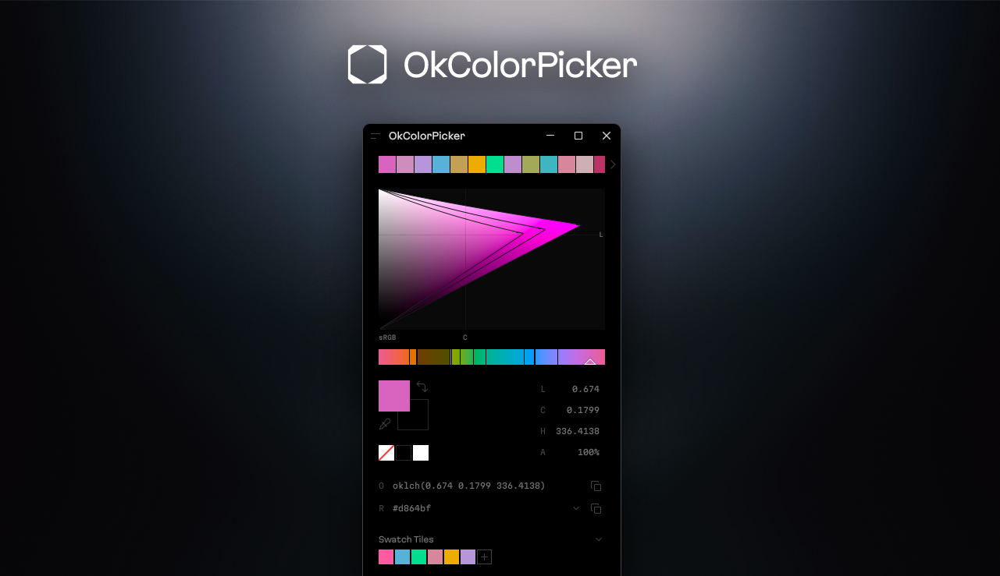

# OkColorPicker

OkColorPicker is a fast, lightweight OKLCH color picker for Windows built in Rust with [zgui](https://github.com/zortax/zgui). Explore lightness, chroma, or hue slices, pick colors directly from your screen, and copy them in CSS format.  
OKLCH lets you vary lightness while keeping hue and chroma fixed, which makes
it easier to build a set of shades that look evenly spaced. It also syncs colors live with eight painting and drawing apps, including CLIP STUDIO PAINT, Photoshop, and Illustrator.

> [zgui](https://github.com/zortax/zgui) is still in experimental development, but it focuses on maximum efficiency in Rust UI, capturing and updating only the UI elements that need changes, going further in efficiency than egui and gpui.

**[Download OkColorPicker for Windows x64](https://github.com/sheetau/OkColorPicker/releases/latest)**

## Install

1. Download the Windows x64 file ending in `-setup.exe` from [Releases](https://github.com/sheetau/OkColorPicker/releases/latest).
2. Run Setup. It installs OkColorPicker for your Windows account and downloads
   the Microsoft Visual C++ runtime if needed. Windows may ask for administrator
   approval for the runtime.
3. Open **OkColorPicker** from the Start menu. A DirectX 12-capable GPU is required.

## Color tools

- **Picker** — Edit main and sub colors in OKLCH, sample from the desktop, and
  work in sRGB, Display P3 or Rec.2020.
- **Harmony** — Explore variations and similar named colors. Lock the colors
  you want to keep and generate a palette around them.
- **APCA** — Choose a text or background color, set a contrast target, and
  explore colors that reach it in your working gamut.

All three tools share your recent colors and swatch folders. The picker restores
them between sessions. [Color tools guide](docs/TOOLS.md)

## Connect another app

Right-click the connection button in the status bar to choose an app, then
left-click its abbreviation to connect. In Harmony, **Send palette** exports
the current palette. In Picker or APCA, **Send swatches** exports the open
folder. These exports are available for the Adobe apps, Krita and Aseprite.

| App                | Connection                                                                                                               |
| ------------------ | ------------------------------------------------------------------------------------------------------------------------ |
| CLIP STUDIO PAINT  | Display the Companion Mode QR code to sync main and sub colors in both directions. [Pairing guide](docs/CSP_PROTOCOL.md) |
| Photoshop          | Send the foreground and background colors to Photoshop.                                                                  |
| Illustrator        | Send fill and stroke to document defaults and selected artwork.                                                          |
| InDesign           | Update named swatches and the fill and stroke of selected frames.                                                        |
| Krita and Aseprite | Use the included plugin or script to sync foreground and background colors in both directions.                           |
| Obsidian           | Use the included desktop plugin to sync colors in notes and Canvas.                                                      |
| Rebelle 8 Pro      | Enable its local WebSocket server to send the active picker color to the brush.                                          |

[Plugin installation and connection instructions](packaging/START_HERE.txt)

## Useful shortcuts

| Action                               | Shortcut                   |
| ------------------------------------ | -------------------------- |
| Open Picker, Harmony or APCA         | Ctrl+1, Ctrl+2 or Ctrl+3   |
| Cycle through tools                  | Ctrl+Tab or Ctrl+Shift+Tab |
| Sample a color from the screen       | Ctrl+Shift+C (hold Alt to freeze the screen) |
| Edit lightness, chroma, hue or alpha | L, C, H or A               |
| Undo or redo a color edit            | Ctrl+Z or Ctrl+Shift+Z     |

## License and source

OkColorPicker is distributed under the [Apache License 2.0](LICENSE-APACHE).
Open **Settings → Licenses and sources** for the third-party notices and matching
source archives installed with the app. [Development guide](docs/DEVELOPMENT.md)
